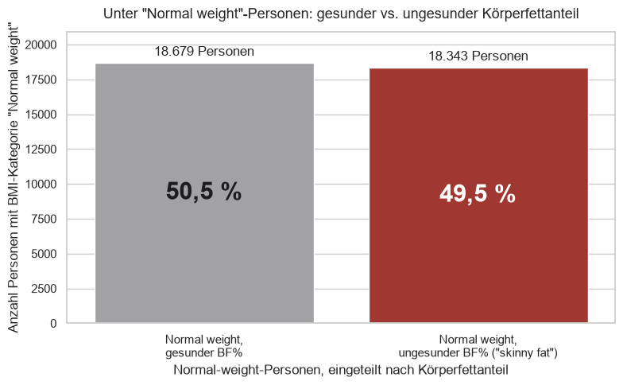

# Health Data Explorer – explorative Datenanalyse mit Python

**Python · pandas · seaborn · matplotlib · Datenqualität · Interpretation**

*Exploratory data analysis of 50,000 health records in pandas: data checks, ten questions, and the finding that BMI hides half of the unhealthy body-fat cases.*

> Kursprojekt (Weiterbildung AI Power Data Analyst) mit einem Kursdatensatz von 50.000 Personen. Der Datensatz ist nicht enthalten.

## Die Frage
Was sagen Größe, Gewicht, Alter, Geschlecht, Aktivität und Rauchen über BMI und Körperfettanteil aus? Und wo führen einfache Kennzahlen in die Irre?

## Ergebnis
- **BMI und Körperfett laufen oft auseinander:** 49,5 % der Menschen mit „Normal weight“ laut BMI (18.343 von 37.022) haben trotzdem einen ungesunden Körperfettanteil.
- **Mehr Aktivität, weniger Körperfett, aber nur leicht:** Der Durchschnitt sinkt gleichmäßig von 29,6 % (Sedentary) auf 26,5 % (Very Active).
- **Ab 45 Jahren verschiebt sich das Bild:** Der Anteil mit Normalgewicht sinkt von 74,0 % auf 64,5 %, der Großteil davon wandert in „Overweight“.

## Vorgehen
1. **Daten prüfen, bevor gerechnet wird:** 96 exakte Duplikate gefunden, per Gegenprobe als wahrscheinlich zufällig eingeordnet und deshalb dokumentiert statt gelöscht. Einen Tippfehler in einer Kategorie bereinigt und die Entscheidung begründet.
2. **Sieben vorgegebene und drei eigene Fragen**, jeweils mit Code, Grafik und schriftlicher Interpretation.
3. **Ehrliche Einordnung:** Auffällige Muster werden auf Fallzahlen geprüft, bevor sie als Befund gelten.

Das Notebook mit allen Ergebnissen: [`HealthDataExplorer.ipynb`](HealthDataExplorer.ipynb). Die Präsentation: [`docs/Praesentation.pdf`](docs/Praesentation.pdf).

**Tech:** Python, pandas, NumPy, matplotlib, seaborn, Jupyter/Colab.

---
Fanuel Hintza · Controller mit 8 Jahren Konzernerfahrung · [LinkedIn](https://www.linkedin.com/in/fanuel-hintza)
